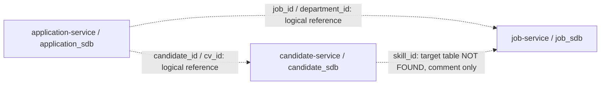

# ATS Database Architecture

## Database Per Service

```text
job-service         -> job_sdb
candidate-service   -> candidate_sdb
application-service -> application_sdb
```

Nguồn: 3 file `ats_parrent/services/{service}/src/main/resources/application.yml`, `spring.datasource.url`. Cả ba dùng PostgreSQL localhost:5432 và database name riêng; không suy ra 3 DB server độc lập. Ngày audit: 14/10/2026. Chỉ tạo schema/documentation, không thay Java/YAML hoặc thực thi migration.

## Why Database Per Service

Trong ATS hiện tại, mỗi service có datasource, entity package và JpaRepository riêng. ApplicationServiceImpl.create() gọi JobClient/CandidateClient qua Feign để kiểm tra dữ liệu thuộc service khác, rồi lưu Application vào application_sdb. Application chỉ giữ UUID jobId và Long candidateId/cvId; không import JPA entity từ job/candidate. Vì vậy SQL chỉ enforce relationship trong từng database, còn existence/trạng thái cross-service do API/application logic xử lý.

## Cross-Service References

| Source column | Target / meaning from source | Database FK? |
|---|---|---|
| applications.job_id | jobs.id, UUID; JobClient.findById | Không |
| applications.candidate_id | candidates.id, BIGINT; CandidateClient.getCandidateById | Không |
| applications.cv_id | cvs.id, BIGINT, comment/field reference | Không |
| applications.department_id | snapshot department UUID, Department.id | Không |
| candidate_skills.skill_id | comment nói job-service.skills.id nhưng Skill entity/table NOT FOUND | Không; không tạo skills |
| candidates.user_id | Keycloak sub UUID | Không |
| jobs.recruiter_id | comment nói Keycloak/Identity, nhưng Java Long | Không; giữ BIGINT |
| departments.manager_id | Long scalar, target chưa xác định trong source | Không |
| evaluation_notes.author_id | Keycloak user identifier VARCHAR(100) | Không |
| interview_interviewers.user_id | Keycloak user identifier VARCHAR(100) | Không |
| applications.transferred_from | Long scalar; quan hệ JPA/target không được khai báo | Không self-FK |
| candidates.cv_file_id | comment trỏ CV hiện tại cvs.id; @Column Long, không @JoinColumn | Chưa thêm FK; cần quyết định |

Nguồn: Application.java, CandidateEntity.java, CandidateSkillEntity.java, Job.java, Department.java, EvaluationNote.java, InterviewInterviewer.java trong đúng service; cùng JobClient/CandidateClient và ApplicationServiceImpl. Logical reference và column name không tự tạo database constraint.

## Database Summary

| Service | Database | Main Tables | Purpose |
|---|---|---|---|
| job-service | job_sdb | departments, jobs | Job/department |
| candidate-service | candidate_sdb | candidates, candidate_skills, cvs | Candidate/CV/skills references |
| application-service | application_sdb | interview_templates, pipeline_stages, applications, actionable_email_tokens, evaluation_notes, interviews, stage_transitions, interview_interviewers | Application/pipeline/interview/token |

## Entity Audit

| Service | Entity | Table | Primary Key | Relationships |
|---|---|---|---|---|
| job-service | Department | departments | UUID GenerationType.UUID | Inverse only / không owning FK |
| job-service | Job | jobs | UUID GenerationType.UUID | department → departments |
| candidate-service | CandidateEntity | candidates | BIGINT IDENTITY | Inverse only / không owning FK |
| candidate-service | CandidateSkillEntity | candidate_skills | BIGINT IDENTITY | candidate → candidates |
| candidate-service | CvEntity | cvs | BIGINT IDENTITY | candidate → candidates |
| application-service | InterviewTemplate | interview_templates | BIGINT IDENTITY | Inverse only / không owning FK |
| application-service | PipelineStage | pipeline_stages | BIGINT IDENTITY | Inverse only / không owning FK |
| application-service | Application | applications | BIGINT IDENTITY | pipelineStage → pipeline_stages |
| application-service | ActionableEmailToken | actionable_email_tokens | BIGINT IDENTITY | application → applications |
| application-service | EvaluationNote | evaluation_notes | BIGINT IDENTITY | application → applications, stage → pipeline_stages |
| application-service | Interview | interviews | BIGINT IDENTITY | application → applications, interviewTemplate → interview_templates |
| application-service | StageTransition | stage_transitions | BIGINT IDENTITY | application → applications, fromStage → pipeline_stages, toStage → pipeline_stages |
| application-service | InterviewInterviewer | interview_interviewers | BIGINT IDENTITY | interview → interviews |

Không tạo table cho BaseAuditEntity (@MappedSuperclass), InterviewFeedback (@Embeddable), CandidateAggregate (domain object), ParsedCvData/Education/Experience (JSON value object) hoặc enum. Source links và checklist từng field ở 3 tài liệu service.

## ERD Overview



Nét đứt là logical reference, không phải FK. ERD chi tiết từng DB: [job-service](job-service-schema.md#erd), [candidate-service](candidate-service-schema.md#erd), [application-service](application-service-schema.md#erd).

## Internal Foreign Keys

| Database/service | From | To | Source |
|---|---|---|---|
| job-service | jobs.department_id | departments.id | Job.department @ManyToOne/@JoinColumn |
| candidate-service | candidate_skills.candidate_id | candidates.id | CandidateSkillEntity.candidate @ManyToOne/@JoinColumn |
| candidate-service | cvs.candidate_id | candidates.id | CvEntity.candidate @ManyToOne/@JoinColumn |
| application-service | applications.pipeline_stage_id | pipeline_stages.id | Application.pipelineStage @ManyToOne/@JoinColumn |
| application-service | actionable_email_tokens.application_id | applications.id | ActionableEmailToken.application @ManyToOne/@JoinColumn |
| application-service | evaluation_notes.application_id | applications.id | EvaluationNote.application @ManyToOne/@JoinColumn |
| application-service | evaluation_notes.stage_id | pipeline_stages.id | EvaluationNote.stage @ManyToOne/@JoinColumn |
| application-service | interviews.application_id | applications.id | Interview.application @ManyToOne/@JoinColumn |
| application-service | interviews.interview_template_id | interview_templates.id | Interview.interviewTemplate @ManyToOne/@JoinColumn |
| application-service | stage_transitions.application_id | applications.id | StageTransition.application @ManyToOne/@JoinColumn |
| application-service | stage_transitions.from_stage_id | pipeline_stages.id | StageTransition.fromStage @ManyToOne/@JoinColumn |
| application-service | stage_transitions.to_stage_id | pipeline_stages.id | StageTransition.toStage @ManyToOne/@JoinColumn |
| application-service | interview_interviewers.interview_id | interviews.id | InterviewInterviewer.interview @ManyToOne/@JoinColumn |

## Index Decisions

| Service | Table | Index | Origin / reason |
|---|---|---|---|
| job-service | jobs | idx_jobs_title (title) | Đề xuất từ query: JobRepository.existsByTitle(String): equality lookup; không thêm UNIQUE vì entity chưa khai báo. |
| job-service | jobs | idx_jobs_department_id (department_id) | Đề xuất từ relationship: Job.department @ManyToOne/@JoinColumn: hỗ trợ JOIN nội bộ và tải collection mappedBy phía parent. |
| candidate-service | candidates | ux_candidates_user_id (user_id) | Entity: @Table.indexes trong CandidateEntity.java |
| candidate-service | candidate_skills | ux_candidate_skills_candidate_skill (candidate_id, skill_id) | Entity: @Table.uniqueConstraints trong CandidateSkillEntity.java |
| candidate-service | cvs | idx_cvs_candidate_id (candidate_id) | Đề xuất từ relationship: CvEntity.candidate @ManyToOne/@JoinColumn: hỗ trợ JOIN nội bộ và tải collection mappedBy phía parent. |
| application-service | pipeline_stages | idx_pipeline_stages_default_order (is_default, stage_order) | Đề xuất từ query: PipelineStageRepository.findByDefaultStage và findFirstByDefaultStageTrueOrderByStageOrderAsc: WHERE và ORDER BY. |
| application-service | applications | idx_applications_job_id (job_id) | Entity: @Table.indexes trong Application.java |
| application-service | applications | idx_applications_candidate_id (candidate_id) | Entity: @Table.indexes trong Application.java |
| application-service | applications | idx_applications_status (status) | Entity: @Table.indexes trong Application.java |
| application-service | applications | idx_applications_job_candidate_status (job_id, candidate_id, status) | Đề xuất từ query: ApplicationRepository.existsByJobIdAndCandidateIdAndStatusNot: lọc cặp job/candidate và status <> tham số. |
| application-service | applications | idx_applications_pipeline_stage_id (pipeline_stage_id) | Đề xuất từ relationship: Application.pipelineStage @ManyToOne/@JoinColumn: hỗ trợ JOIN nội bộ. |
| application-service | actionable_email_tokens | idx_actionable_email_tokens_hash (token_hash) | Entity: @Table.indexes trong ActionableEmailToken.java |
| application-service | actionable_email_tokens | idx_actionable_email_tokens_application_id (application_id) | Đề xuất từ relationship: ActionableEmailToken.application @ManyToOne/@JoinColumn: hỗ trợ JOIN nội bộ và tải collection mappedBy phía parent. |
| application-service | evaluation_notes | idx_evaluation_notes_application_id (application_id) | Đề xuất từ relationship: EvaluationNote.application @ManyToOne/@JoinColumn: hỗ trợ JOIN nội bộ và tải collection mappedBy phía parent. |
| application-service | evaluation_notes | idx_evaluation_notes_stage_id (stage_id) | Đề xuất từ relationship: EvaluationNote.stage @ManyToOne/@JoinColumn: hỗ trợ JOIN nội bộ. |
| application-service | interviews | idx_interviews_application_id (application_id) | Đề xuất từ relationship: Interview.application @ManyToOne/@JoinColumn: hỗ trợ JOIN nội bộ và tải collection mappedBy phía parent. |
| application-service | interviews | idx_interviews_interview_template_id (interview_template_id) | Đề xuất từ relationship: Interview.interviewTemplate @ManyToOne/@JoinColumn: hỗ trợ JOIN nội bộ. |
| application-service | stage_transitions | idx_stage_transitions_application_id (application_id) | Đề xuất từ relationship: StageTransition.application @ManyToOne/@JoinColumn: hỗ trợ JOIN nội bộ và tải collection mappedBy phía parent. |
| application-service | stage_transitions | idx_stage_transitions_from_stage_id (from_stage_id) | Đề xuất từ relationship: StageTransition.fromStage @ManyToOne/@JoinColumn: hỗ trợ JOIN nội bộ. |
| application-service | stage_transitions | idx_stage_transitions_to_stage_id (to_stage_id) | Đề xuất từ relationship: StageTransition.toStage @ManyToOne/@JoinColumn: hỗ trợ JOIN nội bộ. |
| application-service | interview_interviewers | ux_interview_interviewer_user (interview_id, user_id) | Entity: @Table.uniqueConstraints trong InterviewInterviewer.java |

Mỗi table còn có PK backing index tự động. Không thêm unique title, unique active application, unique default stage, unique token hash hoặc arbitrary status index ngoài @Index hiện tại. Index đề xuất từ query/relationship là non-unique, không thay data validity. Unique candidates.user_id được gộp tránh hai backing indexes giống nhau.

## Validation & Usage

- Source inventory: 13 @Entity → 13 CREATE TABLE; 13 PK; 13 FK nội bộ; 3 UNIQUE constraints; 8 CHECK enum. 2 UUID-generated IDs và 11 identity IDs. Không có GenerationType.SEQUENCE hoặc manual PK trong entity hiện tại.
- Kiểm tra tĩnh đã pass: 134 physical columns, named @Column/@JoinColumn có trong SQL, length và NOT NULL theo annotation, FK chỉ trỏ table cùng file đã tạo trước và cùng PK type, index chỉ dùng cột tồn tại, không có destructive statement. Link tài liệu/SQL đều resolve. 18 CREATE INDEX gồm 4 index khai báo entity và 14 index đề xuất; 3 UNIQUE constraints tự có backing index riêng (ngoài 13 PK indexes).
- Source-derived static comparison bao gồm column name/type/nullability/length/precision/enum, inherited/embedded fields và owning relationships. Column details + per-field checklist trong mỗi service document.
- SQL dùng BEGIN/COMMIT và public search_path. Chỉ dùng cho database/schema trống đã chuẩn bị; cố ý không IF NOT EXISTS để không che schema lệch. Không tạo database, không DROP/DELETE, không seed hoặc đổi ddl-auto.
- Chưa chạy PostgreSQL parser/server hoặc Hibernate schema validation. Không có psql trong PATH ở lúc khảo sát. Không khẳng định schema đã áp dụng hay runtime validation đã pass.
- Java lifecycle callbacks/defaults không biến thành SQL default/trigger. Raw SQL insert phải tự cung cấp các audit timestamps/boolean NOT NULL khi không qua entity lifecycle.

## Decisions Still Required

- Job/Department dùng GenerationType.UUID: Hibernate cấp UUID; SQL không tự thêm gen_random_uuid() hoặc sequence. Insert trực tiếp cần cung cấp UUID.
- Job.department bắt buộc theo @JoinColumn(nullable=false), mặc dù JobServiceImpl.save() bỏ qua department không tìm thấy: đường ghi này có thể thất bại; không nới schema.
- existsByTitle() là kiểm tra ứng dụng, không phải unique annotation. SQL thêm index non-unique; UNIQUE title và salary checks chỉ là quyết định tương lai, không thêm vào schema.
- salary_min/max nullable theo entity dù service gọi compareTo(); DTO @Min và business rule salaryMax >= salaryMin không được tự nâng thành DB constraints.
- recruiter_id comment nói Keycloak nhưng Java là Long; manager_id cũng Long không có relationship. Giữ BIGINT, không tạo identity/user table.
- Job audit fields bị comment và getter getMib() không phải persistent field (field access): không tạo cột audit hoặc mib.

- CvEntity comment nói extends BaseAuditEntity nhưng class thực tế không extends: không thêm created_at/updated_at/created_by/updated_by/is_deleted vào cvs.
- CandidateEntity.cvFileId có comment trỏ cvs.id nhưng chỉ @Column Long, không @JoinColumn hoặc @ForeignKey. Giữ cv_file_id BIGINT nullable, chưa thêm FK. Có cần FK nội bộ và kiểm tra CV thuộc đúng candidate là quyết định cần xác nhận.
- CandidateSkillEntity.skillId comment nói job-service.skills.id; job-service hiện không có Skill entity/table. Giữ logical ID BIGINT, không tự tạo skills hoặc FK.
- CandidateEntity.userId là Keycloak UUID, unique và NOT NULL. @Column(unique=true) và @Index(unique=true) cùng user_id được gộp thành một UNIQUE constraint tên ux_candidates_user_id và một backing index; không tạo hai index giống nhau.
- duplicate=false là Java @Builder.Default; không thêm SQL DEFAULT. parse_status không có SQL DEFAULT PENDING vì source chỉ mô tả trong comment.
- ParsedCvData và nested Education/Experience là JSON value objects, không @Entity; không tạo table/cột riêng từ các JSON key.
- CandidateAggregate không @Entity; domain CandidateRepository.findByUserId là contract, CandidateJpaRepository chỉ có JpaRepository CRUD. Không suy ra custom query chưa triển khai.
- DTO fullName @NotBlank và domain source allowlist không làm @Column nullable=false hoặc DB CHECK. Giữ nullable theo persistence entity.

- BaseAuditEntity là @MappedSuperclass: 5 cột audit được đưa vào cả 8 table; không tạo table base_audit_entity. @PrePersist/@PreUpdate cấp timestamps ở Java, không tạo DEFAULT now() hoặc trigger. is_deleted boolean primitive nhưng không SQL DEFAULT.
- InterviewFeedback là @Embeddable: 6 field nằm trong interviews; không có table interview_feedback. score/result nullable, không tự thêm khoảng điểm hoặc result default.
- Application.jobId/candidateId/cvId/departmentId chỉ scalar ID; không có FK cross-service. transferredFrom cũng chỉ @Column Long: không tự thêm self-FK khi chưa có mapping.
- ApplicationRepository.existsByJobIdAndCandidateIdAndStatusNot() có kiểm tra chống trùng trong service nhưng entity không khai báo UNIQUE; chỉ tạo composite non-unique index. Partial unique index cho hồ sơ chưa WITHDRAWN cần quyết định riêng vì làm mạnh hơn JPA mapping và xử lý concurrency khác.
- PipelineStage.defaultStage không có UNIQUE và stageOrder không có UNIQUE. findByDefaultStage(true) có thể gặp nhiều dòng; SQL không ép chỉ một default và không seed stage tự động. create() gọi findByDefaultStage(true); helper getDefaultStage() không được gọi trong create().
- ActionableEmailToken.tokenHash có index non-unique theo entity; không tự thêm UNIQUE, mail table hoặc JWT secret.
- ORM cascade ALL/orphanRemoval không tự đồng nghĩa ON DELETE CASCADE. FK SQL dùng mặc định NO ACTION, không thêm cascade/soft-delete trigger.
- OffsetDateTime dùng TIMESTAMP WITH TIME ZONE; PostgreSQL lưu instant, không giữ nguyên timezone offset của input.

## Files Created

| File | Content |
|---|---|
| database/job-service/schema.sql | Reviewable PostgreSQL baseline |
| docs/database/job-service-schema.md | Tables, columns, relationships, indexes, ERD, checklist |
| database/candidate-service/schema.sql | Reviewable PostgreSQL baseline |
| docs/database/candidate-service-schema.md | Tables, columns, relationships, indexes, ERD, checklist |
| database/application-service/schema.sql | Reviewable PostgreSQL baseline |
| docs/database/application-service-schema.md | Tables, columns, relationships, indexes, ERD, checklist |
| docs/database/ATS_DATABASE_OVERVIEW.md | Entity audit, DB per service, logical references, FK/index summary, open questions |
