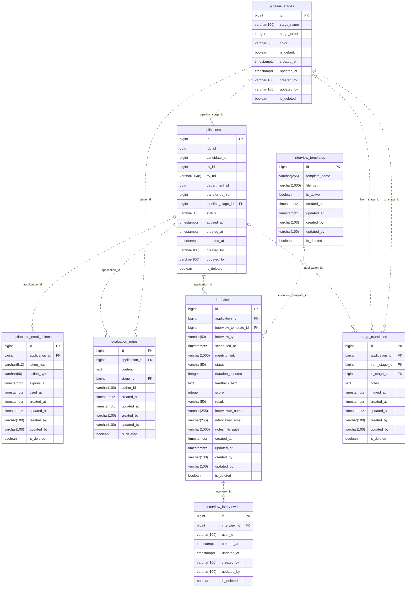

# Database Overview

Service: `application-service`. Database: `application_sdb`. Source: `ats_parrent/services/application-service/src/main/resources/application.yml` (`spring.datasource.url`, PostgreSQL driver, `ddl-auto=update`, PhysicalNamingStrategyStandardImpl). Audit ngày 14/10/2026; chỉ tạo SQL/documentation, chưa thực thi DDL hoặc schema validate trên DB.

SQL: [schema.sql](../../database/application-service/schema.sql). Kết nối đúng database đã có, với public schema trống, trước khi chạy. SQL không tạo database, không xử lý upgrade schema cũ, không thay ddl-auto. Các FK/unique/check lấy từ mapping; index đề xuất được phân biệt dưới đây.

# Tables

| Entity | Table | Primary Key | Relationships |
|---|---|---|---|
| InterviewTemplate | interview_templates | id BIGINT (IDENTITY) | Không có owning relationship |
| PipelineStage | pipeline_stages | id BIGINT (IDENTITY) | Không có owning relationship |
| Application | applications | id BIGINT (IDENTITY) | pipelineStage → pipeline_stages |
| ActionableEmailToken | actionable_email_tokens | id BIGINT (IDENTITY) | application → applications |
| EvaluationNote | evaluation_notes | id BIGINT (IDENTITY) | application → applications, stage → pipeline_stages |
| Interview | interviews | id BIGINT (IDENTITY) | application → applications, interviewTemplate → interview_templates |
| StageTransition | stage_transitions | id BIGINT (IDENTITY) | application → applications, fromStage → pipeline_stages, toStage → pipeline_stages |
| InterviewInterviewer | interview_interviewers | id BIGINT (IDENTITY) | interview → interviews |

# Table Details

## interview_templates

Purpose: Template phỏng vấn và file path.

Source: `ats_parrent/services/application-service/src/main/java/fu/ats/entity/InterviewTemplate.java` + `ats_parrent/services/application-service/src/main/java/fu/ats/entity/BaseAuditEntity.java`.

Columns:

| Column | PostgreSQL Type | Nullable | Constraint | Description |
|---|---|---|---|---|
| id | BIGINT | NO | PK; IDENTITY | `InterviewTemplate.id`: Java Long |
| template_name | VARCHAR(255) | NO | — | `InterviewTemplate.templateName`: Java String |
| file_path | VARCHAR(1000) | NO | — | `InterviewTemplate.filePath`: Java String |
| is_active | BOOLEAN | NO | — | `InterviewTemplate.active`: Java boolean |
| created_at | TIMESTAMP WITH TIME ZONE | NO | — | `BaseAuditEntity.createdAt`: Java OffsetDateTime; inherited audit |
| updated_at | TIMESTAMP WITH TIME ZONE | NO | — | `BaseAuditEntity.updatedAt`: Java OffsetDateTime; inherited audit |
| created_by | VARCHAR(100) | YES | — | `BaseAuditEntity.createdBy`: Java String; inherited audit |
| updated_by | VARCHAR(100) | YES | — | `BaseAuditEntity.updatedBy`: Java String; inherited audit |
| is_deleted | BOOLEAN | NO | — | `BaseAuditEntity.deleted`: Java boolean; inherited audit |

Relationships:

| From | Relation | To | Meaning |
|---|---|---|---|
| interview_templates | — | — | Không có JPA relationship |

Indexes:

| Index | Columns | Reason |
|---|---|---|
| pk_interview_templates | id | PostgreSQL backing index cho @Id/PK |

JPA validation checklist (đối chiếu source tĩnh; chưa chạy Hibernate validate):

| Entity field | Column | Match? |
|---|---|---|
| InterviewTemplate.id | id | YES: BIGINT, NOT NULL; annotation/type/length/enum/PK/FK như bảng trên |
| InterviewTemplate.templateName | template_name | YES: VARCHAR(255), NOT NULL; annotation/type/length/enum/PK/FK như bảng trên |
| InterviewTemplate.filePath | file_path | YES: VARCHAR(1000), NOT NULL; annotation/type/length/enum/PK/FK như bảng trên |
| InterviewTemplate.active | is_active | YES: BOOLEAN, NOT NULL; annotation/type/length/enum/PK/FK như bảng trên |
| BaseAuditEntity.createdAt | created_at | YES: TIMESTAMP WITH TIME ZONE, NOT NULL; annotation/type/length/enum/PK/FK như bảng trên |
| BaseAuditEntity.updatedAt | updated_at | YES: TIMESTAMP WITH TIME ZONE, NOT NULL; annotation/type/length/enum/PK/FK như bảng trên |
| BaseAuditEntity.createdBy | created_by | YES: VARCHAR(100), nullable; annotation/type/length/enum/PK/FK như bảng trên |
| BaseAuditEntity.updatedBy | updated_by | YES: VARCHAR(100), nullable; annotation/type/length/enum/PK/FK như bảng trên |
| BaseAuditEntity.deleted | is_deleted | YES: BOOLEAN, NOT NULL; annotation/type/length/enum/PK/FK như bảng trên |

## pipeline_stages

Purpose: Các bước pipeline, thứ tự và dấu default; được PipelineStageRepository tra cứu.

Source: `ats_parrent/services/application-service/src/main/java/fu/ats/entity/PipelineStage.java` + `ats_parrent/services/application-service/src/main/java/fu/ats/entity/BaseAuditEntity.java`.

Columns:

| Column | PostgreSQL Type | Nullable | Constraint | Description |
|---|---|---|---|---|
| id | BIGINT | NO | PK; IDENTITY | `PipelineStage.id`: Java Long |
| stage_name | VARCHAR(100) | NO | — | `PipelineStage.stageName`: Java String |
| stage_order | INTEGER | NO | — | `PipelineStage.stageOrder`: Java Integer |
| color | VARCHAR(30) | YES | — | `PipelineStage.color`: Java String |
| is_default | BOOLEAN | NO | — | `PipelineStage.defaultStage`: Java boolean |
| created_at | TIMESTAMP WITH TIME ZONE | NO | — | `BaseAuditEntity.createdAt`: Java OffsetDateTime; inherited audit |
| updated_at | TIMESTAMP WITH TIME ZONE | NO | — | `BaseAuditEntity.updatedAt`: Java OffsetDateTime; inherited audit |
| created_by | VARCHAR(100) | YES | — | `BaseAuditEntity.createdBy`: Java String; inherited audit |
| updated_by | VARCHAR(100) | YES | — | `BaseAuditEntity.updatedBy`: Java String; inherited audit |
| is_deleted | BOOLEAN | NO | — | `BaseAuditEntity.deleted`: Java boolean; inherited audit |

Relationships:

| From | Relation | To | Meaning |
|---|---|---|---|
| pipeline_stages | — | — | Không có JPA relationship |

Indexes:

| Index | Columns | Reason |
|---|---|---|
| pk_pipeline_stages | id | PostgreSQL backing index cho @Id/PK |
| idx_pipeline_stages_default_order | is_default, stage_order | Đề xuất từ query: PipelineStageRepository.findByDefaultStage và findFirstByDefaultStageTrueOrderByStageOrderAsc: WHERE và ORDER BY. |

JPA validation checklist (đối chiếu source tĩnh; chưa chạy Hibernate validate):

| Entity field | Column | Match? |
|---|---|---|
| PipelineStage.id | id | YES: BIGINT, NOT NULL; annotation/type/length/enum/PK/FK như bảng trên |
| PipelineStage.stageName | stage_name | YES: VARCHAR(100), NOT NULL; annotation/type/length/enum/PK/FK như bảng trên |
| PipelineStage.stageOrder | stage_order | YES: INTEGER, NOT NULL; annotation/type/length/enum/PK/FK như bảng trên |
| PipelineStage.color | color | YES: VARCHAR(30), nullable; annotation/type/length/enum/PK/FK như bảng trên |
| PipelineStage.defaultStage | is_default | YES: BOOLEAN, NOT NULL; annotation/type/length/enum/PK/FK như bảng trên |
| BaseAuditEntity.createdAt | created_at | YES: TIMESTAMP WITH TIME ZONE, NOT NULL; annotation/type/length/enum/PK/FK như bảng trên |
| BaseAuditEntity.updatedAt | updated_at | YES: TIMESTAMP WITH TIME ZONE, NOT NULL; annotation/type/length/enum/PK/FK như bảng trên |
| BaseAuditEntity.createdBy | created_by | YES: VARCHAR(100), nullable; annotation/type/length/enum/PK/FK như bảng trên |
| BaseAuditEntity.updatedBy | updated_by | YES: VARCHAR(100), nullable; annotation/type/length/enum/PK/FK như bảng trên |
| BaseAuditEntity.deleted | is_deleted | YES: BOOLEAN, NOT NULL; annotation/type/length/enum/PK/FK như bảng trên |

## applications

Purpose: Hồ sơ ứng tuyển; ApplicationServiceImpl kiểm tra job/candidate qua Feign rồi lưu.

Source: `ats_parrent/services/application-service/src/main/java/fu/ats/entity/Application.java` + `ats_parrent/services/application-service/src/main/java/fu/ats/entity/BaseAuditEntity.java`.

Columns:

| Column | PostgreSQL Type | Nullable | Constraint | Description |
|---|---|---|---|---|
| id | BIGINT | NO | PK; IDENTITY | `Application.id`: Java Long |
| job_id | UUID | NO | — | `Application.jobId`: Java UUID |
| candidate_id | BIGINT | NO | — | `Application.candidateId`: Java Long |
| cv_id | BIGINT | YES | — | `Application.cvId`: Java Long |
| cv_url | VARCHAR(2048) | NO | — | `Application.cvUrl`: Java String |
| department_id | UUID | YES | — | `Application.departmentId`: Java UUID |
| transferred_from | BIGINT | YES | — | `Application.transferredFrom`: Java Long |
| pipeline_stage_id | BIGINT | NO | FK → pipeline_stages.id | `Application.pipelineStage`: Java PipelineStage |
| status | VARCHAR(50) | NO | CHECK SUBMITTED, IN_REVIEW, INTERVIEWING, OFFERED, HIRED, REJECTED, WITHDRAWN | `Application.status`: Java ApplicationStatus |
| applied_at | TIMESTAMP WITH TIME ZONE | NO | — | `Application.appliedAt`: Java OffsetDateTime |
| created_at | TIMESTAMP WITH TIME ZONE | NO | — | `BaseAuditEntity.createdAt`: Java OffsetDateTime; inherited audit |
| updated_at | TIMESTAMP WITH TIME ZONE | NO | — | `BaseAuditEntity.updatedAt`: Java OffsetDateTime; inherited audit |
| created_by | VARCHAR(100) | YES | — | `BaseAuditEntity.createdBy`: Java String; inherited audit |
| updated_by | VARCHAR(100) | YES | — | `BaseAuditEntity.updatedBy`: Java String; inherited audit |
| is_deleted | BOOLEAN | NO | — | `BaseAuditEntity.deleted`: Java boolean; inherited audit |

Relationships:

| From | Relation | To | Meaning |
|---|---|---|---|
| applications.pipeline_stage_id | ManyToOne required | pipeline_stages.id | FK nội bộ; Application.pipelineStage |
| applications | OneToMany mappedBy=application | stage_transitions | inverse collection; không thêm join table/cột ở parent |
| applications | OneToMany mappedBy=application | evaluation_notes | inverse collection; không thêm join table/cột ở parent |
| applications | OneToMany mappedBy=application | interviews | inverse collection; không thêm join table/cột ở parent |
| applications | OneToMany mappedBy=application | actionable_email_tokens | inverse collection; không thêm join table/cột ở parent |

Indexes:

| Index | Columns | Reason |
|---|---|---|
| pk_applications | id | PostgreSQL backing index cho @Id/PK |
| idx_applications_job_id | job_id | Entity: @Table.indexes trong Application.java |
| idx_applications_candidate_id | candidate_id | Entity: @Table.indexes trong Application.java |
| idx_applications_status | status | Entity: @Table.indexes trong Application.java |
| idx_applications_job_candidate_status | job_id, candidate_id, status | Đề xuất từ query: ApplicationRepository.existsByJobIdAndCandidateIdAndStatusNot: lọc cặp job/candidate và status <> tham số. |
| idx_applications_pipeline_stage_id | pipeline_stage_id | Đề xuất từ relationship: Application.pipelineStage @ManyToOne/@JoinColumn: hỗ trợ JOIN nội bộ. |

JPA validation checklist (đối chiếu source tĩnh; chưa chạy Hibernate validate):

| Entity field | Column | Match? |
|---|---|---|
| Application.id | id | YES: BIGINT, NOT NULL; annotation/type/length/enum/PK/FK như bảng trên |
| Application.jobId | job_id | YES: UUID, NOT NULL; annotation/type/length/enum/PK/FK như bảng trên |
| Application.candidateId | candidate_id | YES: BIGINT, NOT NULL; annotation/type/length/enum/PK/FK như bảng trên |
| Application.cvId | cv_id | YES: BIGINT, nullable; annotation/type/length/enum/PK/FK như bảng trên |
| Application.cvUrl | cv_url | YES: VARCHAR(2048), NOT NULL; annotation/type/length/enum/PK/FK như bảng trên |
| Application.departmentId | department_id | YES: UUID, nullable; annotation/type/length/enum/PK/FK như bảng trên |
| Application.transferredFrom | transferred_from | YES: BIGINT, nullable; annotation/type/length/enum/PK/FK như bảng trên |
| Application.pipelineStage | pipeline_stage_id | YES: BIGINT, NOT NULL; annotation/type/length/enum/PK/FK như bảng trên |
| Application.status | status | YES: VARCHAR(50), NOT NULL; annotation/type/length/enum/PK/FK như bảng trên |
| Application.appliedAt | applied_at | YES: TIMESTAMP WITH TIME ZONE, NOT NULL; annotation/type/length/enum/PK/FK như bảng trên |
| BaseAuditEntity.createdAt | created_at | YES: TIMESTAMP WITH TIME ZONE, NOT NULL; annotation/type/length/enum/PK/FK như bảng trên |
| BaseAuditEntity.updatedAt | updated_at | YES: TIMESTAMP WITH TIME ZONE, NOT NULL; annotation/type/length/enum/PK/FK như bảng trên |
| BaseAuditEntity.createdBy | created_by | YES: VARCHAR(100), nullable; annotation/type/length/enum/PK/FK như bảng trên |
| BaseAuditEntity.updatedBy | updated_by | YES: VARCHAR(100), nullable; annotation/type/length/enum/PK/FK như bảng trên |
| BaseAuditEntity.deleted | is_deleted | YES: BOOLEAN, NOT NULL; annotation/type/length/enum/PK/FK như bảng trên |
| Application.stageTransitions | FK owning side ở child, không cột collection | YES: mappedBy; không tạo join table |
| Application.evaluationNotes | FK owning side ở child, không cột collection | YES: mappedBy; không tạo join table |
| Application.interviews | FK owning side ở child, không cột collection | YES: mappedBy; không tạo join table |
| Application.actionableEmailTokens | FK owning side ở child, không cột collection | YES: mappedBy; không tạo join table |

## actionable_email_tokens

Purpose: Hash token thao tác trên application, action type và thời gian hết hạn/sử dụng; không suy ra mail sending implementation.

Source: `ats_parrent/services/application-service/src/main/java/fu/ats/entity/ActionableEmailToken.java` + `ats_parrent/services/application-service/src/main/java/fu/ats/entity/BaseAuditEntity.java`.

Columns:

| Column | PostgreSQL Type | Nullable | Constraint | Description |
|---|---|---|---|---|
| id | BIGINT | NO | PK; IDENTITY | `ActionableEmailToken.id`: Java Long |
| application_id | BIGINT | NO | FK → applications.id | `ActionableEmailToken.application`: Java Application |
| token_hash | VARCHAR(512) | NO | — | `ActionableEmailToken.tokenHash`: Java String |
| action_type | VARCHAR(50) | NO | CHECK CONFIRM_INTERVIEW, CANCEL_INTERVIEW, SUBMIT_FEEDBACK | `ActionableEmailToken.actionType`: Java ActionType |
| expires_at | TIMESTAMP WITH TIME ZONE | NO | — | `ActionableEmailToken.expiresAt`: Java OffsetDateTime |
| used_at | TIMESTAMP WITH TIME ZONE | YES | — | `ActionableEmailToken.usedAt`: Java OffsetDateTime |
| created_at | TIMESTAMP WITH TIME ZONE | NO | — | `BaseAuditEntity.createdAt`: Java OffsetDateTime; inherited audit |
| updated_at | TIMESTAMP WITH TIME ZONE | NO | — | `BaseAuditEntity.updatedAt`: Java OffsetDateTime; inherited audit |
| created_by | VARCHAR(100) | YES | — | `BaseAuditEntity.createdBy`: Java String; inherited audit |
| updated_by | VARCHAR(100) | YES | — | `BaseAuditEntity.updatedBy`: Java String; inherited audit |
| is_deleted | BOOLEAN | NO | — | `BaseAuditEntity.deleted`: Java boolean; inherited audit |

Relationships:

| From | Relation | To | Meaning |
|---|---|---|---|
| actionable_email_tokens.application_id | ManyToOne required | applications.id | FK nội bộ; ActionableEmailToken.application |

Indexes:

| Index | Columns | Reason |
|---|---|---|
| pk_actionable_email_tokens | id | PostgreSQL backing index cho @Id/PK |
| idx_actionable_email_tokens_hash | token_hash | Entity: @Table.indexes trong ActionableEmailToken.java |
| idx_actionable_email_tokens_application_id | application_id | Đề xuất từ relationship: ActionableEmailToken.application @ManyToOne/@JoinColumn: hỗ trợ JOIN nội bộ và tải collection mappedBy phía parent. |

JPA validation checklist (đối chiếu source tĩnh; chưa chạy Hibernate validate):

| Entity field | Column | Match? |
|---|---|---|
| ActionableEmailToken.id | id | YES: BIGINT, NOT NULL; annotation/type/length/enum/PK/FK như bảng trên |
| ActionableEmailToken.application | application_id | YES: BIGINT, NOT NULL; annotation/type/length/enum/PK/FK như bảng trên |
| ActionableEmailToken.tokenHash | token_hash | YES: VARCHAR(512), NOT NULL; annotation/type/length/enum/PK/FK như bảng trên |
| ActionableEmailToken.actionType | action_type | YES: VARCHAR(50), NOT NULL; annotation/type/length/enum/PK/FK như bảng trên |
| ActionableEmailToken.expiresAt | expires_at | YES: TIMESTAMP WITH TIME ZONE, NOT NULL; annotation/type/length/enum/PK/FK như bảng trên |
| ActionableEmailToken.usedAt | used_at | YES: TIMESTAMP WITH TIME ZONE, nullable; annotation/type/length/enum/PK/FK như bảng trên |
| BaseAuditEntity.createdAt | created_at | YES: TIMESTAMP WITH TIME ZONE, NOT NULL; annotation/type/length/enum/PK/FK như bảng trên |
| BaseAuditEntity.updatedAt | updated_at | YES: TIMESTAMP WITH TIME ZONE, NOT NULL; annotation/type/length/enum/PK/FK như bảng trên |
| BaseAuditEntity.createdBy | created_by | YES: VARCHAR(100), nullable; annotation/type/length/enum/PK/FK như bảng trên |
| BaseAuditEntity.updatedBy | updated_by | YES: VARCHAR(100), nullable; annotation/type/length/enum/PK/FK như bảng trên |
| BaseAuditEntity.deleted | is_deleted | YES: BOOLEAN, NOT NULL; annotation/type/length/enum/PK/FK như bảng trên |

## evaluation_notes

Purpose: Ghi chú đánh giá application, stage tùy chọn và author ID.

Source: `ats_parrent/services/application-service/src/main/java/fu/ats/entity/EvaluationNote.java` + `ats_parrent/services/application-service/src/main/java/fu/ats/entity/BaseAuditEntity.java`.

Columns:

| Column | PostgreSQL Type | Nullable | Constraint | Description |
|---|---|---|---|---|
| id | BIGINT | NO | PK; IDENTITY | `EvaluationNote.id`: Java Long |
| application_id | BIGINT | NO | FK → applications.id | `EvaluationNote.application`: Java Application |
| content | TEXT | NO | — | `EvaluationNote.content`: Java String |
| stage_id | BIGINT | YES | FK → pipeline_stages.id | `EvaluationNote.stage`: Java PipelineStage |
| author_id | VARCHAR(100) | NO | — | `EvaluationNote.authorId`: Java String |
| created_at | TIMESTAMP WITH TIME ZONE | NO | — | `BaseAuditEntity.createdAt`: Java OffsetDateTime; inherited audit |
| updated_at | TIMESTAMP WITH TIME ZONE | NO | — | `BaseAuditEntity.updatedAt`: Java OffsetDateTime; inherited audit |
| created_by | VARCHAR(100) | YES | — | `BaseAuditEntity.createdBy`: Java String; inherited audit |
| updated_by | VARCHAR(100) | YES | — | `BaseAuditEntity.updatedBy`: Java String; inherited audit |
| is_deleted | BOOLEAN | NO | — | `BaseAuditEntity.deleted`: Java boolean; inherited audit |

Relationships:

| From | Relation | To | Meaning |
|---|---|---|---|
| evaluation_notes.application_id | ManyToOne required | applications.id | FK nội bộ; EvaluationNote.application |
| evaluation_notes.stage_id | ManyToOne optional | pipeline_stages.id | FK nội bộ; EvaluationNote.stage |

Indexes:

| Index | Columns | Reason |
|---|---|---|
| pk_evaluation_notes | id | PostgreSQL backing index cho @Id/PK |
| idx_evaluation_notes_application_id | application_id | Đề xuất từ relationship: EvaluationNote.application @ManyToOne/@JoinColumn: hỗ trợ JOIN nội bộ và tải collection mappedBy phía parent. |
| idx_evaluation_notes_stage_id | stage_id | Đề xuất từ relationship: EvaluationNote.stage @ManyToOne/@JoinColumn: hỗ trợ JOIN nội bộ. |

JPA validation checklist (đối chiếu source tĩnh; chưa chạy Hibernate validate):

| Entity field | Column | Match? |
|---|---|---|
| EvaluationNote.id | id | YES: BIGINT, NOT NULL; annotation/type/length/enum/PK/FK như bảng trên |
| EvaluationNote.application | application_id | YES: BIGINT, NOT NULL; annotation/type/length/enum/PK/FK như bảng trên |
| EvaluationNote.content | content | YES: TEXT, NOT NULL; annotation/type/length/enum/PK/FK như bảng trên |
| EvaluationNote.stage | stage_id | YES: BIGINT, nullable; annotation/type/length/enum/PK/FK như bảng trên |
| EvaluationNote.authorId | author_id | YES: VARCHAR(100), NOT NULL; annotation/type/length/enum/PK/FK như bảng trên |
| BaseAuditEntity.createdAt | created_at | YES: TIMESTAMP WITH TIME ZONE, NOT NULL; annotation/type/length/enum/PK/FK như bảng trên |
| BaseAuditEntity.updatedAt | updated_at | YES: TIMESTAMP WITH TIME ZONE, NOT NULL; annotation/type/length/enum/PK/FK như bảng trên |
| BaseAuditEntity.createdBy | created_by | YES: VARCHAR(100), nullable; annotation/type/length/enum/PK/FK như bảng trên |
| BaseAuditEntity.updatedBy | updated_by | YES: VARCHAR(100), nullable; annotation/type/length/enum/PK/FK như bảng trên |
| BaseAuditEntity.deleted | is_deleted | YES: BOOLEAN, NOT NULL; annotation/type/length/enum/PK/FK như bảng trên |

## interviews

Purpose: Lịch/trạng thái/type phỏng vấn, template và feedback embedded.

Source: `ats_parrent/services/application-service/src/main/java/fu/ats/entity/Interview.java` + `ats_parrent/services/application-service/src/main/java/fu/ats/entity/BaseAuditEntity.java`.

Columns:

| Column | PostgreSQL Type | Nullable | Constraint | Description |
|---|---|---|---|---|
| id | BIGINT | NO | PK; IDENTITY | `Interview.id`: Java Long |
| application_id | BIGINT | NO | FK → applications.id | `Interview.application`: Java Application |
| interview_template_id | BIGINT | NO | FK → interview_templates.id | `Interview.interviewTemplate`: Java InterviewTemplate |
| interview_type | VARCHAR(50) | NO | CHECK PHONE, VIDEO, ONSITE, TECHNICAL, HR | `Interview.interviewType`: Java InterviewType |
| scheduled_at | TIMESTAMP WITH TIME ZONE | NO | — | `Interview.scheduledAt`: Java OffsetDateTime |
| meeting_link | VARCHAR(1000) | YES | — | `Interview.meetingLink`: Java String |
| status | VARCHAR(50) | NO | CHECK SCHEDULED, COMPLETED, CANCELLED, NO_SHOW | `Interview.status`: Java InterviewStatus |
| duration_minutes | INTEGER | YES | — | `Interview.durationMinutes`: Java Integer |
| feedback_text | TEXT | YES | — | `Interview.feedback.feedbackText` (khai báo trong InterviewFeedback): Java String; embedded, không table riêng |
| score | INTEGER | YES | — | `Interview.feedback.score` (khai báo trong InterviewFeedback): Java Integer; embedded, không table riêng |
| result | VARCHAR(50) | YES | CHECK PENDING, PASS, FAIL | `Interview.feedback.result` (khai báo trong InterviewFeedback): Java InterviewResult; embedded, không table riêng |
| interviewer_name | VARCHAR(255) | YES | — | `Interview.feedback.interviewerName` (khai báo trong InterviewFeedback): Java String; embedded, không table riêng |
| interviewer_email | VARCHAR(255) | YES | — | `Interview.feedback.interviewerEmail` (khai báo trong InterviewFeedback): Java String; embedded, không table riêng |
| notes_file_path | VARCHAR(1000) | YES | — | `Interview.feedback.notesFilePath` (khai báo trong InterviewFeedback): Java String; embedded, không table riêng |
| created_at | TIMESTAMP WITH TIME ZONE | NO | — | `BaseAuditEntity.createdAt`: Java OffsetDateTime; inherited audit |
| updated_at | TIMESTAMP WITH TIME ZONE | NO | — | `BaseAuditEntity.updatedAt`: Java OffsetDateTime; inherited audit |
| created_by | VARCHAR(100) | YES | — | `BaseAuditEntity.createdBy`: Java String; inherited audit |
| updated_by | VARCHAR(100) | YES | — | `BaseAuditEntity.updatedBy`: Java String; inherited audit |
| is_deleted | BOOLEAN | NO | — | `BaseAuditEntity.deleted`: Java boolean; inherited audit |

Relationships:

| From | Relation | To | Meaning |
|---|---|---|---|
| interviews.application_id | ManyToOne required | applications.id | FK nội bộ; Interview.application |
| interviews.interview_template_id | ManyToOne required | interview_templates.id | FK nội bộ; Interview.interviewTemplate |
| interviews | OneToMany mappedBy=interview | interview_interviewers | inverse collection; không thêm join table/cột ở parent |

Indexes:

| Index | Columns | Reason |
|---|---|---|
| pk_interviews | id | PostgreSQL backing index cho @Id/PK |
| idx_interviews_application_id | application_id | Đề xuất từ relationship: Interview.application @ManyToOne/@JoinColumn: hỗ trợ JOIN nội bộ và tải collection mappedBy phía parent. |
| idx_interviews_interview_template_id | interview_template_id | Đề xuất từ relationship: Interview.interviewTemplate @ManyToOne/@JoinColumn: hỗ trợ JOIN nội bộ. |

JPA validation checklist (đối chiếu source tĩnh; chưa chạy Hibernate validate):

| Entity field | Column | Match? |
|---|---|---|
| Interview.id | id | YES: BIGINT, NOT NULL; annotation/type/length/enum/PK/FK như bảng trên |
| Interview.application | application_id | YES: BIGINT, NOT NULL; annotation/type/length/enum/PK/FK như bảng trên |
| Interview.interviewTemplate | interview_template_id | YES: BIGINT, NOT NULL; annotation/type/length/enum/PK/FK như bảng trên |
| Interview.interviewType | interview_type | YES: VARCHAR(50), NOT NULL; annotation/type/length/enum/PK/FK như bảng trên |
| Interview.scheduledAt | scheduled_at | YES: TIMESTAMP WITH TIME ZONE, NOT NULL; annotation/type/length/enum/PK/FK như bảng trên |
| Interview.meetingLink | meeting_link | YES: VARCHAR(1000), nullable; annotation/type/length/enum/PK/FK như bảng trên |
| Interview.status | status | YES: VARCHAR(50), NOT NULL; annotation/type/length/enum/PK/FK như bảng trên |
| Interview.durationMinutes | duration_minutes | YES: INTEGER, nullable; annotation/type/length/enum/PK/FK như bảng trên |
| Interview.feedback.feedbackText (InterviewFeedback.feedbackText) | feedback_text | YES: TEXT, nullable; annotation/type/length/enum/PK/FK như bảng trên |
| Interview.feedback.score (InterviewFeedback.score) | score | YES: INTEGER, nullable; annotation/type/length/enum/PK/FK như bảng trên |
| Interview.feedback.result (InterviewFeedback.result) | result | YES: VARCHAR(50), nullable; annotation/type/length/enum/PK/FK như bảng trên |
| Interview.feedback.interviewerName (InterviewFeedback.interviewerName) | interviewer_name | YES: VARCHAR(255), nullable; annotation/type/length/enum/PK/FK như bảng trên |
| Interview.feedback.interviewerEmail (InterviewFeedback.interviewerEmail) | interviewer_email | YES: VARCHAR(255), nullable; annotation/type/length/enum/PK/FK như bảng trên |
| Interview.feedback.notesFilePath (InterviewFeedback.notesFilePath) | notes_file_path | YES: VARCHAR(1000), nullable; annotation/type/length/enum/PK/FK như bảng trên |
| BaseAuditEntity.createdAt | created_at | YES: TIMESTAMP WITH TIME ZONE, NOT NULL; annotation/type/length/enum/PK/FK như bảng trên |
| BaseAuditEntity.updatedAt | updated_at | YES: TIMESTAMP WITH TIME ZONE, NOT NULL; annotation/type/length/enum/PK/FK như bảng trên |
| BaseAuditEntity.createdBy | created_by | YES: VARCHAR(100), nullable; annotation/type/length/enum/PK/FK như bảng trên |
| BaseAuditEntity.updatedBy | updated_by | YES: VARCHAR(100), nullable; annotation/type/length/enum/PK/FK như bảng trên |
| BaseAuditEntity.deleted | is_deleted | YES: BOOLEAN, NOT NULL; annotation/type/length/enum/PK/FK như bảng trên |
| Interview.interviewers | FK owning side ở child, không cột collection | YES: mappedBy; không tạo join table |

## stage_transitions

Purpose: Các lần chuyển pipeline stage của application.

Source: `ats_parrent/services/application-service/src/main/java/fu/ats/entity/StageTransition.java` + `ats_parrent/services/application-service/src/main/java/fu/ats/entity/BaseAuditEntity.java`.

Columns:

| Column | PostgreSQL Type | Nullable | Constraint | Description |
|---|---|---|---|---|
| id | BIGINT | NO | PK; IDENTITY | `StageTransition.id`: Java Long |
| application_id | BIGINT | NO | FK → applications.id | `StageTransition.application`: Java Application |
| from_stage_id | BIGINT | YES | FK → pipeline_stages.id | `StageTransition.fromStage`: Java PipelineStage |
| to_stage_id | BIGINT | NO | FK → pipeline_stages.id | `StageTransition.toStage`: Java PipelineStage |
| notes | TEXT | YES | — | `StageTransition.notes`: Java String |
| moved_at | TIMESTAMP WITH TIME ZONE | NO | — | `StageTransition.movedAt`: Java OffsetDateTime |
| created_at | TIMESTAMP WITH TIME ZONE | NO | — | `BaseAuditEntity.createdAt`: Java OffsetDateTime; inherited audit |
| updated_at | TIMESTAMP WITH TIME ZONE | NO | — | `BaseAuditEntity.updatedAt`: Java OffsetDateTime; inherited audit |
| created_by | VARCHAR(100) | YES | — | `BaseAuditEntity.createdBy`: Java String; inherited audit |
| updated_by | VARCHAR(100) | YES | — | `BaseAuditEntity.updatedBy`: Java String; inherited audit |
| is_deleted | BOOLEAN | NO | — | `BaseAuditEntity.deleted`: Java boolean; inherited audit |

Relationships:

| From | Relation | To | Meaning |
|---|---|---|---|
| stage_transitions.application_id | ManyToOne required | applications.id | FK nội bộ; StageTransition.application |
| stage_transitions.from_stage_id | ManyToOne optional | pipeline_stages.id | FK nội bộ; StageTransition.fromStage |
| stage_transitions.to_stage_id | ManyToOne required | pipeline_stages.id | FK nội bộ; StageTransition.toStage |

Indexes:

| Index | Columns | Reason |
|---|---|---|
| pk_stage_transitions | id | PostgreSQL backing index cho @Id/PK |
| idx_stage_transitions_application_id | application_id | Đề xuất từ relationship: StageTransition.application @ManyToOne/@JoinColumn: hỗ trợ JOIN nội bộ và tải collection mappedBy phía parent. |
| idx_stage_transitions_from_stage_id | from_stage_id | Đề xuất từ relationship: StageTransition.fromStage @ManyToOne/@JoinColumn: hỗ trợ JOIN nội bộ. |
| idx_stage_transitions_to_stage_id | to_stage_id | Đề xuất từ relationship: StageTransition.toStage @ManyToOne/@JoinColumn: hỗ trợ JOIN nội bộ. |

JPA validation checklist (đối chiếu source tĩnh; chưa chạy Hibernate validate):

| Entity field | Column | Match? |
|---|---|---|
| StageTransition.id | id | YES: BIGINT, NOT NULL; annotation/type/length/enum/PK/FK như bảng trên |
| StageTransition.application | application_id | YES: BIGINT, NOT NULL; annotation/type/length/enum/PK/FK như bảng trên |
| StageTransition.fromStage | from_stage_id | YES: BIGINT, nullable; annotation/type/length/enum/PK/FK như bảng trên |
| StageTransition.toStage | to_stage_id | YES: BIGINT, NOT NULL; annotation/type/length/enum/PK/FK như bảng trên |
| StageTransition.notes | notes | YES: TEXT, nullable; annotation/type/length/enum/PK/FK như bảng trên |
| StageTransition.movedAt | moved_at | YES: TIMESTAMP WITH TIME ZONE, NOT NULL; annotation/type/length/enum/PK/FK như bảng trên |
| BaseAuditEntity.createdAt | created_at | YES: TIMESTAMP WITH TIME ZONE, NOT NULL; annotation/type/length/enum/PK/FK như bảng trên |
| BaseAuditEntity.updatedAt | updated_at | YES: TIMESTAMP WITH TIME ZONE, NOT NULL; annotation/type/length/enum/PK/FK như bảng trên |
| BaseAuditEntity.createdBy | created_by | YES: VARCHAR(100), nullable; annotation/type/length/enum/PK/FK như bảng trên |
| BaseAuditEntity.updatedBy | updated_by | YES: VARCHAR(100), nullable; annotation/type/length/enum/PK/FK như bảng trên |
| BaseAuditEntity.deleted | is_deleted | YES: BOOLEAN, NOT NULL; annotation/type/length/enum/PK/FK như bảng trên |

## interview_interviewers

Purpose: Các user ID được gắn vào một interview.

Source: `ats_parrent/services/application-service/src/main/java/fu/ats/entity/InterviewInterviewer.java` + `ats_parrent/services/application-service/src/main/java/fu/ats/entity/BaseAuditEntity.java`.

Columns:

| Column | PostgreSQL Type | Nullable | Constraint | Description |
|---|---|---|---|---|
| id | BIGINT | NO | PK; IDENTITY | `InterviewInterviewer.id`: Java Long |
| interview_id | BIGINT | NO | FK → interviews.id; UNIQUE(interview_id, user_id) | `InterviewInterviewer.interview`: Java Interview |
| user_id | VARCHAR(100) | NO | UNIQUE(interview_id, user_id) | `InterviewInterviewer.userId`: Java String |
| created_at | TIMESTAMP WITH TIME ZONE | NO | — | `BaseAuditEntity.createdAt`: Java OffsetDateTime; inherited audit |
| updated_at | TIMESTAMP WITH TIME ZONE | NO | — | `BaseAuditEntity.updatedAt`: Java OffsetDateTime; inherited audit |
| created_by | VARCHAR(100) | YES | — | `BaseAuditEntity.createdBy`: Java String; inherited audit |
| updated_by | VARCHAR(100) | YES | — | `BaseAuditEntity.updatedBy`: Java String; inherited audit |
| is_deleted | BOOLEAN | NO | — | `BaseAuditEntity.deleted`: Java boolean; inherited audit |

Relationships:

| From | Relation | To | Meaning |
|---|---|---|---|
| interview_interviewers.interview_id | ManyToOne required | interviews.id | FK nội bộ; InterviewInterviewer.interview |

Indexes:

| Index | Columns | Reason |
|---|---|---|
| pk_interview_interviewers | id | PostgreSQL backing index cho @Id/PK |
| ux_interview_interviewer_user | interview_id, user_id | Entity: @Table.uniqueConstraints trong InterviewInterviewer.java UNIQUE backing index; không tạo index trùng. |

JPA validation checklist (đối chiếu source tĩnh; chưa chạy Hibernate validate):

| Entity field | Column | Match? |
|---|---|---|
| InterviewInterviewer.id | id | YES: BIGINT, NOT NULL; annotation/type/length/enum/PK/FK như bảng trên |
| InterviewInterviewer.interview | interview_id | YES: BIGINT, NOT NULL; annotation/type/length/enum/PK/FK như bảng trên |
| InterviewInterviewer.userId | user_id | YES: VARCHAR(100), NOT NULL; annotation/type/length/enum/PK/FK như bảng trên |
| BaseAuditEntity.createdAt | created_at | YES: TIMESTAMP WITH TIME ZONE, NOT NULL; annotation/type/length/enum/PK/FK như bảng trên |
| BaseAuditEntity.updatedAt | updated_at | YES: TIMESTAMP WITH TIME ZONE, NOT NULL; annotation/type/length/enum/PK/FK như bảng trên |
| BaseAuditEntity.createdBy | created_by | YES: VARCHAR(100), nullable; annotation/type/length/enum/PK/FK như bảng trên |
| BaseAuditEntity.updatedBy | updated_by | YES: VARCHAR(100), nullable; annotation/type/length/enum/PK/FK như bảng trên |
| BaseAuditEntity.deleted | is_deleted | YES: BOOLEAN, NOT NULL; annotation/type/length/enum/PK/FK như bảng trên |

# ERD

ERD chỉ thể hiện FK nội bộ có annotation JPA; scalar logical reference không nối bằng FK. Mọi FK giữ ON DELETE/UPDATE NO ACTION mặc định. Nullable parent được biểu diễn o|; required parent ||; child 0..N.

# Mapping Decisions & Open Questions

- BaseAuditEntity là @MappedSuperclass: 5 cột audit được đưa vào cả 8 table; không tạo table base_audit_entity. @PrePersist/@PreUpdate cấp timestamps ở Java, không tạo DEFAULT now() hoặc trigger. is_deleted boolean primitive nhưng không SQL DEFAULT.
- InterviewFeedback là @Embeddable: 6 field nằm trong interviews; không có table interview_feedback. score/result nullable, không tự thêm khoảng điểm hoặc result default.
- Application.jobId/candidateId/cvId/departmentId chỉ scalar ID; không có FK cross-service. transferredFrom cũng chỉ @Column Long: không tự thêm self-FK khi chưa có mapping.
- ApplicationRepository.existsByJobIdAndCandidateIdAndStatusNot() có kiểm tra chống trùng trong service nhưng entity không khai báo UNIQUE; chỉ tạo composite non-unique index. Partial unique index cho hồ sơ chưa WITHDRAWN cần quyết định riêng vì làm mạnh hơn JPA mapping và xử lý concurrency khác.
- PipelineStage.defaultStage không có UNIQUE và stageOrder không có UNIQUE. findByDefaultStage(true) có thể gặp nhiều dòng; SQL không ép chỉ một default và không seed stage tự động. create() gọi findByDefaultStage(true); helper getDefaultStage() không được gọi trong create().
- ActionableEmailToken.tokenHash có index non-unique theo entity; không tự thêm UNIQUE, mail table hoặc JWT secret.
- ORM cascade ALL/orphanRemoval không tự đồng nghĩa ON DELETE CASCADE. FK SQL dùng mặc định NO ACTION, không thêm cascade/soft-delete trigger.
- OffsetDateTime dùng TIMESTAMP WITH TIME ZONE; PostgreSQL lưu instant, không giữ nguyên timezone offset của input.

Các CHECK enum dùng chính xác constants hiện tại và vẫn cho NULL khi entity nullable. Không dùng PostgreSQL CREATE TYPE enum. LONG IDENTITY là BIGINT GENERATED BY DEFAULT AS IDENTITY; không dùng SERIAL hoặc tạo sequence generator độc lập. Mọi OffsetDateTime là TIMESTAMP WITH TIME ZONE (cvs.uploaded_at theo columnDefinition timestamptz). Không thêm audit/default/unique/business check ngoài annotation.
