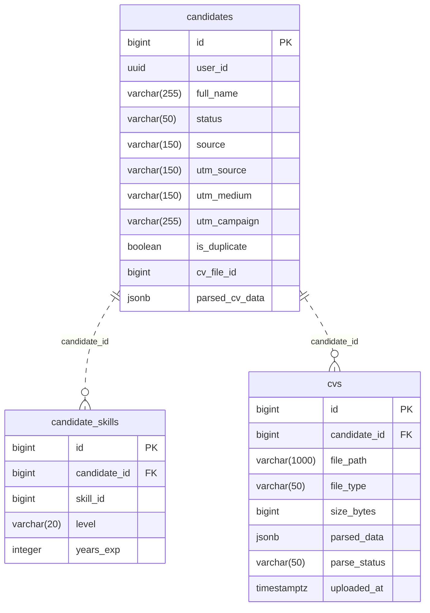

# Database Overview

Service: `candidate-service`. Database: `candidate_sdb`. Source: `ats_parrent/services/candidate-service/src/main/resources/application.yml` (`spring.datasource.url`, PostgreSQL driver, `ddl-auto=update`, PhysicalNamingStrategyStandardImpl). Audit ngày 14/10/2026; chỉ tạo SQL/documentation, chưa thực thi DDL hoặc schema validate trên DB.

SQL: [schema.sql](../../database/candidate-service/schema.sql). Kết nối đúng database đã có, với public schema trống, trước khi chạy. SQL không tạo database, không xử lý upgrade schema cũ, không thay ddl-auto. Các FK/unique/check lấy từ mapping; index đề xuất được phân biệt dưới đây.

# Tables

| Entity | Table | Primary Key | Relationships |
|---|---|---|---|
| CandidateEntity | candidates | id BIGINT (IDENTITY) | Không có owning relationship |
| CandidateSkillEntity | candidate_skills | id BIGINT (IDENTITY) | candidate → candidates |
| CvEntity | cvs | id BIGINT (IDENTITY) | candidate → candidates |

# Table Details

## candidates

Purpose: Hồ sơ candidate, user ID, tracking source và parse result chuẩn hóa.

Source: `ats_parrent/services/candidate-service/src/main/java/fu/ats/infrastructure/persistence/entity/CandidateEntity.java`.

Columns:

| Column | PostgreSQL Type | Nullable | Constraint | Description |
|---|---|---|---|---|
| id | BIGINT | NO | PK; IDENTITY | `CandidateEntity.id`: Java Long |
| user_id | UUID | NO | UNIQUE(user_id) | `CandidateEntity.userId`: Java UUID |
| full_name | VARCHAR(255) | YES | — | `CandidateEntity.fullName`: Java String |
| status | VARCHAR(50) | YES | CHECK ACTIVE, INACTIVE | `CandidateEntity.status`: Java CandidateStatus |
| source | VARCHAR(150) | YES | — | `CandidateEntity.source`: Java String |
| utm_source | VARCHAR(150) | YES | — | `CandidateEntity.utmSource`: Java String |
| utm_medium | VARCHAR(150) | YES | — | `CandidateEntity.utmMedium`: Java String |
| utm_campaign | VARCHAR(255) | YES | — | `CandidateEntity.utmCampaign`: Java String |
| is_duplicate | BOOLEAN | NO | — | `CandidateEntity.duplicate`: Java boolean |
| cv_file_id | BIGINT | YES | — | `CandidateEntity.cvFileId`: Java Long |
| parsed_cv_data | JSONB | YES | — | `CandidateEntity.parsedCvData`: Java ParsedCvData |

Relationships:

| From | Relation | To | Meaning |
|---|---|---|---|
| candidates | OneToMany mappedBy=candidate | cvs | inverse collection; không thêm join table/cột ở parent |
| candidates | OneToMany mappedBy=candidate | candidate_skills | inverse collection; không thêm join table/cột ở parent |

Indexes:

| Index | Columns | Reason |
|---|---|---|
| pk_candidates | id | PostgreSQL backing index cho @Id/PK |
| ux_candidates_user_id | user_id | Entity: @Table.indexes trong CandidateEntity.java UNIQUE backing index; không tạo index trùng. |

JPA validation checklist (đối chiếu source tĩnh; chưa chạy Hibernate validate):

| Entity field | Column | Match? |
|---|---|---|
| CandidateEntity.id | id | YES: BIGINT, NOT NULL; annotation/type/length/enum/PK/FK như bảng trên |
| CandidateEntity.userId | user_id | YES: UUID, NOT NULL; annotation/type/length/enum/PK/FK như bảng trên |
| CandidateEntity.fullName | full_name | YES: VARCHAR(255), nullable; annotation/type/length/enum/PK/FK như bảng trên |
| CandidateEntity.status | status | YES: VARCHAR(50), nullable; annotation/type/length/enum/PK/FK như bảng trên |
| CandidateEntity.source | source | YES: VARCHAR(150), nullable; annotation/type/length/enum/PK/FK như bảng trên |
| CandidateEntity.utmSource | utm_source | YES: VARCHAR(150), nullable; annotation/type/length/enum/PK/FK như bảng trên |
| CandidateEntity.utmMedium | utm_medium | YES: VARCHAR(150), nullable; annotation/type/length/enum/PK/FK như bảng trên |
| CandidateEntity.utmCampaign | utm_campaign | YES: VARCHAR(255), nullable; annotation/type/length/enum/PK/FK như bảng trên |
| CandidateEntity.duplicate | is_duplicate | YES: BOOLEAN, NOT NULL; annotation/type/length/enum/PK/FK như bảng trên |
| CandidateEntity.cvFileId | cv_file_id | YES: BIGINT, nullable; annotation/type/length/enum/PK/FK như bảng trên |
| CandidateEntity.parsedCvData | parsed_cv_data | YES: JSONB, nullable; annotation/type/length/enum/PK/FK như bảng trên |
| CandidateEntity.cvs | FK owning side ở child, không cột collection | YES: mappedBy; không tạo join table |
| CandidateEntity.skills | FK owning side ở child, không cột collection | YES: mappedBy; không tạo join table |

## candidate_skills

Purpose: Danh sách skill ID của candidate và level/years experience.

Source: `ats_parrent/services/candidate-service/src/main/java/fu/ats/infrastructure/persistence/entity/CandidateSkillEntity.java`.

Columns:

| Column | PostgreSQL Type | Nullable | Constraint | Description |
|---|---|---|---|---|
| id | BIGINT | NO | PK; IDENTITY | `CandidateSkillEntity.id`: Java Long |
| candidate_id | BIGINT | NO | FK → candidates.id; UNIQUE(candidate_id, skill_id) | `CandidateSkillEntity.candidate`: Java CandidateEntity |
| skill_id | BIGINT | NO | UNIQUE(candidate_id, skill_id) | `CandidateSkillEntity.skillId`: Java Long |
| level | VARCHAR(20) | YES | — | `CandidateSkillEntity.level`: Java String |
| years_exp | INTEGER | YES | — | `CandidateSkillEntity.yearsExp`: Java Integer |

Relationships:

| From | Relation | To | Meaning |
|---|---|---|---|
| candidate_skills.candidate_id | ManyToOne required | candidates.id | FK nội bộ; CandidateSkillEntity.candidate |

Indexes:

| Index | Columns | Reason |
|---|---|---|
| pk_candidate_skills | id | PostgreSQL backing index cho @Id/PK |
| ux_candidate_skills_candidate_skill | candidate_id, skill_id | Entity: @Table.uniqueConstraints trong CandidateSkillEntity.java UNIQUE backing index; không tạo index trùng. |

JPA validation checklist (đối chiếu source tĩnh; chưa chạy Hibernate validate):

| Entity field | Column | Match? |
|---|---|---|
| CandidateSkillEntity.id | id | YES: BIGINT, NOT NULL; annotation/type/length/enum/PK/FK như bảng trên |
| CandidateSkillEntity.candidate | candidate_id | YES: BIGINT, NOT NULL; annotation/type/length/enum/PK/FK như bảng trên |
| CandidateSkillEntity.skillId | skill_id | YES: BIGINT, NOT NULL; annotation/type/length/enum/PK/FK như bảng trên |
| CandidateSkillEntity.level | level | YES: VARCHAR(20), nullable; annotation/type/length/enum/PK/FK như bảng trên |
| CandidateSkillEntity.yearsExp | years_exp | YES: INTEGER, nullable; annotation/type/length/enum/PK/FK như bảng trên |

## cvs

Purpose: File CV, thông tin file và raw parse result của candidate; không có audit fields thực tế.

Source: `ats_parrent/services/candidate-service/src/main/java/fu/ats/infrastructure/persistence/entity/CvEntity.java`.

Columns:

| Column | PostgreSQL Type | Nullable | Constraint | Description |
|---|---|---|---|---|
| id | BIGINT | NO | PK; IDENTITY | `CvEntity.id`: Java Long |
| candidate_id | BIGINT | NO | FK → candidates.id | `CvEntity.candidate`: Java CandidateEntity |
| file_path | VARCHAR(1000) | YES | — | `CvEntity.filePath`: Java String |
| file_type | VARCHAR(50) | YES | — | `CvEntity.fileType`: Java String |
| size_bytes | BIGINT | YES | — | `CvEntity.sizeBytes`: Java Long |
| parsed_data | JSONB | YES | — | `CvEntity.parsedData`: Java Map<String, Object> |
| parse_status | VARCHAR(50) | YES | CHECK PENDING, PARSED, FAILED | `CvEntity.parseStatus`: Java ParseStatus |
| uploaded_at | TIMESTAMPTZ | YES | — | `CvEntity.uploadedAt`: Java OffsetDateTime |

Relationships:

| From | Relation | To | Meaning |
|---|---|---|---|
| cvs.candidate_id | ManyToOne required | candidates.id | FK nội bộ; CvEntity.candidate |

Indexes:

| Index | Columns | Reason |
|---|---|---|
| pk_cvs | id | PostgreSQL backing index cho @Id/PK |
| idx_cvs_candidate_id | candidate_id | Đề xuất từ relationship: CvEntity.candidate @ManyToOne/@JoinColumn: hỗ trợ JOIN nội bộ và tải collection mappedBy phía parent. |

JPA validation checklist (đối chiếu source tĩnh; chưa chạy Hibernate validate):

| Entity field | Column | Match? |
|---|---|---|
| CvEntity.id | id | YES: BIGINT, NOT NULL; annotation/type/length/enum/PK/FK như bảng trên |
| CvEntity.candidate | candidate_id | YES: BIGINT, NOT NULL; annotation/type/length/enum/PK/FK như bảng trên |
| CvEntity.filePath | file_path | YES: VARCHAR(1000), nullable; annotation/type/length/enum/PK/FK như bảng trên |
| CvEntity.fileType | file_type | YES: VARCHAR(50), nullable; annotation/type/length/enum/PK/FK như bảng trên |
| CvEntity.sizeBytes | size_bytes | YES: BIGINT, nullable; annotation/type/length/enum/PK/FK như bảng trên |
| CvEntity.parsedData | parsed_data | YES: JSONB, nullable; annotation/type/length/enum/PK/FK như bảng trên |
| CvEntity.parseStatus | parse_status | YES: VARCHAR(50), nullable; annotation/type/length/enum/PK/FK như bảng trên |
| CvEntity.uploadedAt | uploaded_at | YES: TIMESTAMPTZ, nullable; annotation/type/length/enum/PK/FK như bảng trên |

# ERD

ERD chỉ thể hiện FK nội bộ có annotation JPA; scalar logical reference không nối bằng FK. Mọi FK giữ ON DELETE/UPDATE NO ACTION mặc định. Nullable parent được biểu diễn o|; required parent ||; child 0..N.

# Mapping Decisions & Open Questions

- CvEntity comment nói extends BaseAuditEntity nhưng class thực tế không extends: không thêm created_at/updated_at/created_by/updated_by/is_deleted vào cvs.
- CandidateEntity.cvFileId có comment trỏ cvs.id nhưng chỉ @Column Long, không @JoinColumn hoặc @ForeignKey. Giữ cv_file_id BIGINT nullable, chưa thêm FK. Có cần FK nội bộ và kiểm tra CV thuộc đúng candidate là quyết định cần xác nhận.
- CandidateSkillEntity.skillId comment nói job-service.skills.id; job-service hiện không có Skill entity/table. Giữ logical ID BIGINT, không tự tạo skills hoặc FK.
- CandidateEntity.userId là Keycloak UUID, unique và NOT NULL. @Column(unique=true) và @Index(unique=true) cùng user_id được gộp thành một UNIQUE constraint tên ux_candidates_user_id và một backing index; không tạo hai index giống nhau.
- duplicate=false là Java @Builder.Default; không thêm SQL DEFAULT. parse_status không có SQL DEFAULT PENDING vì source chỉ mô tả trong comment.
- ParsedCvData và nested Education/Experience là JSON value objects, không @Entity; không tạo table/cột riêng từ các JSON key.
- CandidateAggregate không @Entity; domain CandidateRepository.findByUserId là contract, CandidateJpaRepository chỉ có JpaRepository CRUD. Không suy ra custom query chưa triển khai.
- DTO fullName @NotBlank và domain source allowlist không làm @Column nullable=false hoặc DB CHECK. Giữ nullable theo persistence entity.

Các CHECK enum dùng chính xác constants hiện tại và vẫn cho NULL khi entity nullable. Không dùng PostgreSQL CREATE TYPE enum. LONG IDENTITY là BIGINT GENERATED BY DEFAULT AS IDENTITY; không dùng SERIAL hoặc tạo sequence generator độc lập. Mọi OffsetDateTime là TIMESTAMP WITH TIME ZONE (cvs.uploaded_at theo columnDefinition timestamptz). Không thêm audit/default/unique/business check ngoài annotation.
