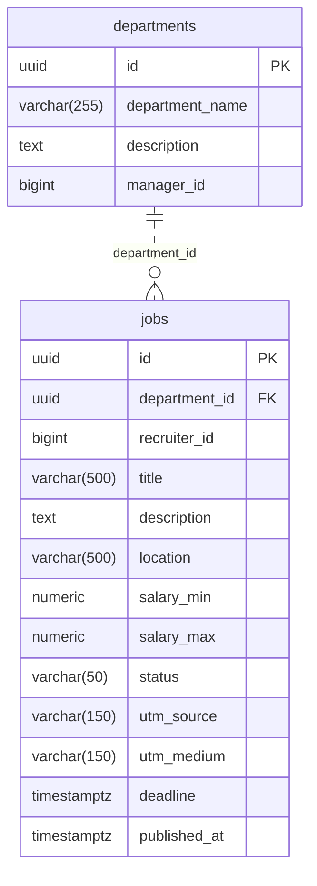

# Database Overview

Service: `job-service`. Database: `job_sdb`. Source: `ats_parrent/services/job-service/src/main/resources/application.yml` (`spring.datasource.url`, PostgreSQL driver, `ddl-auto=update`, PhysicalNamingStrategyStandardImpl). Audit ngày 14/10/2026; chỉ tạo SQL/documentation, chưa thực thi DDL hoặc schema validate trên DB.

SQL: [schema.sql](../../database/job-service/schema.sql). Kết nối đúng database đã có, với public schema trống, trước khi chạy. SQL không tạo database, không xử lý upgrade schema cũ, không thay ddl-auto. Các FK/unique/check lấy từ mapping; index đề xuất được phân biệt dưới đây.

# Tables

| Entity | Table | Primary Key | Relationships |
|---|---|---|---|
| Department | departments | id UUID (UUID, Hibernate) | Không có owning relationship |
| Job | jobs | id UUID (UUID, Hibernate) | department → departments |

# Table Details

## departments

Purpose: Thông tin department và manager ID; được Job tham chiếu.

Source: `ats_parrent/services/job-service/src/main/java/fu/ats/entity/Department.java`.

Columns:

| Column | PostgreSQL Type | Nullable | Constraint | Description |
|---|---|---|---|---|
| id | UUID | NO | PK; UUID cấp bởi Hibernate | `Department.id`: Java UUID |
| department_name | VARCHAR(255) | NO | — | `Department.departmentName`: Java String |
| description | TEXT | YES | — | `Department.description`: Java String |
| manager_id | BIGINT | YES | — | `Department.managerId`: Java Long |

Relationships:

| From | Relation | To | Meaning |
|---|---|---|---|
| departments | OneToMany mappedBy=department | jobs | inverse collection; không thêm join table/cột ở parent |

Indexes:

| Index | Columns | Reason |
|---|---|---|
| pk_departments | id | PostgreSQL backing index cho @Id/PK |

JPA validation checklist (đối chiếu source tĩnh; chưa chạy Hibernate validate):

| Entity field | Column | Match? |
|---|---|---|
| Department.id | id | YES: UUID, NOT NULL; annotation/type/length/enum/PK/FK như bảng trên |
| Department.departmentName | department_name | YES: VARCHAR(255), NOT NULL; annotation/type/length/enum/PK/FK như bảng trên |
| Department.description | description | YES: TEXT, nullable; annotation/type/length/enum/PK/FK như bảng trên |
| Department.managerId | manager_id | YES: BIGINT, nullable; annotation/type/length/enum/PK/FK như bảng trên |
| Department.jobs | FK owning side ở child, không cột collection | YES: mappedBy; không tạo join table |

## jobs

Purpose: Thông tin tuyển dụng; JobServiceImpl tạo job và tìm job theo ID/title.

Source: `ats_parrent/services/job-service/src/main/java/fu/ats/entity/Job.java`.

Columns:

| Column | PostgreSQL Type | Nullable | Constraint | Description |
|---|---|---|---|---|
| id | UUID | NO | PK; UUID cấp bởi Hibernate | `Job.id`: Java UUID |
| department_id | UUID | NO | FK → departments.id | `Job.department`: Java Department |
| recruiter_id | BIGINT | YES | — | `Job.recruiterId`: Java Long |
| title | VARCHAR(500) | NO | — | `Job.title`: Java String |
| description | TEXT | YES | — | `Job.description`: Java String |
| location | VARCHAR(500) | YES | — | `Job.location`: Java String |
| salary_min | NUMERIC(15,2) | YES | — | `Job.salaryMin`: Java BigDecimal |
| salary_max | NUMERIC(15,2) | YES | — | `Job.salaryMax`: Java BigDecimal |
| status | VARCHAR(50) | YES | CHECK DRAFT, PUBLISHED, CLOSED | `Job.status`: Java JobStatus |
| utm_source | VARCHAR(150) | YES | — | `Job.utmSource`: Java String |
| utm_medium | VARCHAR(150) | YES | — | `Job.utmMedium`: Java String |
| deadline | TIMESTAMP WITH TIME ZONE | YES | — | `Job.deadline`: Java OffsetDateTime |
| published_at | TIMESTAMP WITH TIME ZONE | YES | — | `Job.publishedAt`: Java OffsetDateTime |

Relationships:

| From | Relation | To | Meaning |
|---|---|---|---|
| jobs.department_id | ManyToOne required | departments.id | FK nội bộ; Job.department |

Indexes:

| Index | Columns | Reason |
|---|---|---|
| pk_jobs | id | PostgreSQL backing index cho @Id/PK |
| idx_jobs_title | title | Đề xuất từ query: JobRepository.existsByTitle(String): equality lookup; không thêm UNIQUE vì entity chưa khai báo. |
| idx_jobs_department_id | department_id | Đề xuất từ relationship: Job.department @ManyToOne/@JoinColumn: hỗ trợ JOIN nội bộ và tải collection mappedBy phía parent. |

JPA validation checklist (đối chiếu source tĩnh; chưa chạy Hibernate validate):

| Entity field | Column | Match? |
|---|---|---|
| Job.id | id | YES: UUID, NOT NULL; annotation/type/length/enum/PK/FK như bảng trên |
| Job.department | department_id | YES: UUID, NOT NULL; annotation/type/length/enum/PK/FK như bảng trên |
| Job.recruiterId | recruiter_id | YES: BIGINT, nullable; annotation/type/length/enum/PK/FK như bảng trên |
| Job.title | title | YES: VARCHAR(500), NOT NULL; annotation/type/length/enum/PK/FK như bảng trên |
| Job.description | description | YES: TEXT, nullable; annotation/type/length/enum/PK/FK như bảng trên |
| Job.location | location | YES: VARCHAR(500), nullable; annotation/type/length/enum/PK/FK như bảng trên |
| Job.salaryMin | salary_min | YES: NUMERIC(15,2), nullable; annotation/type/length/enum/PK/FK như bảng trên |
| Job.salaryMax | salary_max | YES: NUMERIC(15,2), nullable; annotation/type/length/enum/PK/FK như bảng trên |
| Job.status | status | YES: VARCHAR(50), nullable; annotation/type/length/enum/PK/FK như bảng trên |
| Job.utmSource | utm_source | YES: VARCHAR(150), nullable; annotation/type/length/enum/PK/FK như bảng trên |
| Job.utmMedium | utm_medium | YES: VARCHAR(150), nullable; annotation/type/length/enum/PK/FK như bảng trên |
| Job.deadline | deadline | YES: TIMESTAMP WITH TIME ZONE, nullable; annotation/type/length/enum/PK/FK như bảng trên |
| Job.publishedAt | published_at | YES: TIMESTAMP WITH TIME ZONE, nullable; annotation/type/length/enum/PK/FK như bảng trên |

# ERD

ERD chỉ thể hiện FK nội bộ có annotation JPA; scalar logical reference không nối bằng FK. Mọi FK giữ ON DELETE/UPDATE NO ACTION mặc định. Nullable parent được biểu diễn o|; required parent ||; child 0..N.

# Mapping Decisions & Open Questions

- Job/Department dùng GenerationType.UUID: Hibernate cấp UUID; SQL không tự thêm gen_random_uuid() hoặc sequence. Insert trực tiếp cần cung cấp UUID.
- Job.department bắt buộc theo @JoinColumn(nullable=false), mặc dù JobServiceImpl.save() bỏ qua department không tìm thấy: đường ghi này có thể thất bại; không nới schema.
- existsByTitle() là kiểm tra ứng dụng, không phải unique annotation. SQL thêm index non-unique; UNIQUE title và salary checks chỉ là quyết định tương lai, không thêm vào schema.
- salary_min/max nullable theo entity dù service gọi compareTo(); DTO @Min và business rule salaryMax >= salaryMin không được tự nâng thành DB constraints.
- recruiter_id comment nói Keycloak nhưng Java là Long; manager_id cũng Long không có relationship. Giữ BIGINT, không tạo identity/user table.
- Job audit fields bị comment và getter getMib() không phải persistent field (field access): không tạo cột audit hoặc mib.

Các CHECK enum dùng chính xác constants hiện tại và vẫn cho NULL khi entity nullable. Không dùng PostgreSQL CREATE TYPE enum. LONG IDENTITY là BIGINT GENERATED BY DEFAULT AS IDENTITY; không dùng SERIAL hoặc tạo sequence generator độc lập. Mọi OffsetDateTime là TIMESTAMP WITH TIME ZONE (cvs.uploaded_at theo columnDefinition timestamptz). Không thêm audit/default/unique/business check ngoài annotation.
